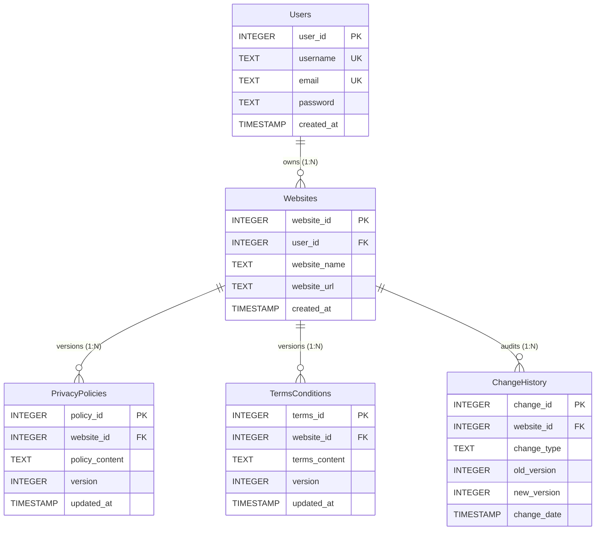

# Privacy Policy and Terms & Conditions Change Tracker

A complete, beginner-friendly **Database Management System (DBMS)** web application developed using **Python (Flask)**, **SQLite**, and **HTML**.

This project helps organizations, legal teams, compliance officers, and regular users track, version, and detect changes in website **Privacy Policies** and **Terms & Conditions** over time.

---

## 📋 Technology Restrictions Compliance

| Requirement | Implementation | Status |
| :--- | :--- | :--- |
| **Backend** | Python 3 (Flask Framework) | ✅ Strict Compliance |
| **Frontend** | Pure Semantic HTML (Standard HTML5 forms, tables, fieldsets, and zero external frameworks) | ✅ Strict Compliance |
| **Database** | SQLite3 with Foreign Keys (`PRAGMA foreign_keys = ON;`) and Cascade Deletions | ✅ Strict Compliance |
| **JavaScript** | **ZERO JavaScript** (No `.js` files, no `<script>` tags, no client-side scripts) | ✅ Strict Compliance |
| **CSS Frameworks** | **ZERO CSS Frameworks** (No Bootstrap, Tailwind, Bulma, CDN links) | ✅ Strict Compliance |
| **Other Languages**| No React, Node.js, PHP, or other languages | ✅ Strict Compliance |

---

## 📁 Project Folder Structure

```text
project/
│
├── app.py                  # Main Flask application (routes, controllers, auth session)
├── database.py             # Database connectivity, helper utilities, and CRUD SQL functions
├── schema.sql              # DDL SQL script defining tables, keys, and foreign constraints
├── sample_data.py          # Database seeding script with realistic multi-version sample data
├── diff_utils.py           # Pure Python diff comparison engine using built-in difflib
├── test_app.py             # Automated unit and integration test suite
├── requirements.txt        # Python package dependencies (Flask, Werkzeug)
├── tracker.db              # SQLite relational database file
├── README.md               # Detailed project documentation and run instructions
│
└── templates/              # Pure HTML Web Pages (Jinja2 templates)
    ├── base.html           # Base layout (header, navigation, flash alerts, footer)
    ├── index.html          # Public Landing / Home Page
    ├── register.html       # User Registration Page
    ├── login.html          # User Login Page
    ├── dashboard.html      # System Dashboard (metrics, websites list, recent updates)
    ├── add_website.html    # Add Website Form (with optional initial policy & terms)
    ├── edit_website.html   # Edit Website Name & URL Form
    ├── website_details.html# Website Hub (current active policy, terms, recent changes)
    ├── update_policy.html  # Update Privacy Policy Form (increments version)
    ├── update_terms.html   # Update Terms & Conditions Form (increments version)
    ├── privacy_history.html# Complete Version History & Archive for Privacy Policy
    ├── terms_history.html  # Complete Version History & Archive for Terms & Conditions
    ├── compare_versions.html# Side-by-Side and Unified Diff Change Viewer
    └── history.html        # Global Change Audit Log across all websites
```

---

## 🗄️ Database Management & Schema Explanation

The application uses an SQLite relational database (`tracker.db`) structured into **5 relational tables**:



### Table Details & Relationship Descriptions:

1. **`Users` Table**:
   - `user_id` (INTEGER, Primary Key, Auto Increment): Unique identifier for each user.
   - `username` (TEXT, Unique, Not Null): Alphanumeric login identifier.
   - `email` (TEXT, Unique, Not Null): User email address.
   - `password` (TEXT, Not Null): Securely hashed password generated using PBKDF2:SHA256.
   - `created_at` (TIMESTAMP): Account registration timestamp.

2. **`Websites` Table**:
   - `website_id` (INTEGER, Primary Key, Auto Increment): Unique identifier for each website.
   - `user_id` (INTEGER, Foreign Key &rarr; `Users(user_id)`): Associates the website with its owner.
   - `website_name` (TEXT, Not Null): Name of the tracked website (e.g., "Acme Cloud Services").
   - `website_url` (TEXT, Not Null): Official URL of the website.
   - `created_at` (TIMESTAMP): Timestamp when tracking started.
   - **Relationship**: Many-to-One with `Users`. `ON DELETE CASCADE` ensures deleting a user removes all their tracked websites.

3. **`PrivacyPolicies` Table**:
   - `policy_id` (INTEGER, Primary Key, Auto Increment): Unique record ID.
   - `website_id` (INTEGER, Foreign Key &rarr; `Websites(website_id)`): Identifies which website this policy belongs to.
   - `policy_content` (TEXT, Not Null): Full text content of this version of the policy.
   - `version` (INTEGER, Not Null): Sequential version number (v1, v2, v3, etc.).
   - `updated_at` (TIMESTAMP): Timestamp when this version was created.
   - **Relationship**: One-to-Many (`Websites` &rarr; `PrivacyPolicies`). Multiple versions are stored without overwriting older revisions.

4. **`TermsConditions` Table**:
   - `terms_id` (INTEGER, Primary Key, Auto Increment): Unique record ID.
   - `website_id` (INTEGER, Foreign Key &rarr; `Websites(website_id)`): Associated website.
   - `terms_content` (TEXT, Not Null): Full text content of this version of terms & conditions.
   - `version` (INTEGER, Not Null): Sequential version number (v1, v2, v3, etc.).
   - `updated_at` (TIMESTAMP): Timestamp when this version was created.
   - **Relationship**: One-to-Many (`Websites` &rarr; `TermsConditions`).

5. **`ChangeHistory` Table**:
   - `change_id` (INTEGER, Primary Key, Auto Increment): Unique change log ID.
   - `website_id` (INTEGER, Foreign Key &rarr; `Websites(website_id)`): The website modified.
   - `change_type` (TEXT, Not Null): Type of document updated (`'Privacy Policy'` or `'Terms & Conditions'`).
   - `old_version` (INTEGER): Previous version number (NULL for initial version 1).
   - `new_version` (INTEGER, Not Null): Newly created version number.
   - `change_date` (TIMESTAMP): Exact date and time the update occurred.
   - **Relationship**: One-to-Many (`Websites` &rarr; `ChangeHistory`).

---

## 🛠️ CRUD Operations Summary

| Entity | Create | Read | Update | Delete |
| :--- | :--- | :--- | :--- | :--- |
| **Users** | User registration with hashed password | Authentication login & session check | Profile & password verification | Session logout |
| **Websites** | Add new website (`/websites/add`) | List on Dashboard & search by name/URL | Edit website name and URL (`/websites/<id>/edit`) | Delete website (`ON DELETE CASCADE`) |
| **Privacy Policy**| Save initial version or update (`/privacy/update`) | View current active content & version history list | Add new version increment (v1 &rarr; v2) | Delete version / cascade |
| **Terms & Conditions**| Save initial version or update (`/terms/update`) | View current active content & version history list | Add new version increment (v1 &rarr; v2) | Delete version / cascade |
| **Change History**| Auto-recorded on every policy/terms creation or update | View site-specific history & global audit log (`/history`) | Version comparison with diff view | Cascade deletion with website |

---

## 🔍 Pure Python Diff & Change Detection

Without using any JavaScript, diff comparison is computed on the backend in Python using the standard `difflib` library in [diff_utils.py](file:///c:/Users/USER/OneDrive/Desktop/project/diff_utils.py):

1. **Change Metrics**:
   - Analyzes additions, deletions, and unchanged lines via `difflib.SequenceMatcher`.
2. **Side-by-Side Comparison**:
   - Generates a 2-column comparison table comparing Version A (Left) and Version B (Right) with green line additions and red deletions.
3. **Line-by-Line (Unified) Diff**:
   - Outputs unified diff blocks with `[+]` added and `[-]` deleted line indicators rendered directly in HTML.

---

## 🚀 Step-by-Step Instructions to Run in VS Code

### Step 1: Open Project in VS Code
1. Launch **Visual Studio Code**.
2. Go to **File** &rarr; **Open Folder...** (or press `Ctrl+K Ctrl+O`).
3. Select this folder: `c:\Users\USER\OneDrive\Desktop\project`.

### Step 2: Open Integrated Terminal
1. In VS Code, open the terminal by pressing `` Ctrl+` `` (Ctrl + Backtick) or selecting **Terminal** &rarr; **New Terminal**.
2. Make sure you are in the project folder:
   ```powershell
   pwd
   ```

### Step 3: Install Required Python Packages
Run the following command in the VS Code terminal:
```powershell
pip install -r requirements.txt
```
*(Flask and Werkzeug will be installed. `sqlite3` and `difflib` come pre-installed with Python).*

### Step 4: Populate Sample Data (Optional but Recommended)
To pre-populate realistic sample websites, multi-version privacy policies, terms, and test accounts:
```powershell
python sample_data.py
```

### Step 5: Run the Web Application
Start the Flask web server:
```powershell
python app.py
```
You will see output similar to:
```text
 * Serving Flask app 'app'
 * Debug mode: on
 * Running on http://127.0.0.1:5000
Press CTRL+C to quit
```

### Step 6: Access the Application in Your Browser
Open your web browser (Chrome, Edge, Firefox) and navigate to:
```text
http://127.0.0.1:5000
```

---

## 🔑 Pre-Seeded Sample Accounts

| Role | Username | Password | Included Sample Data |
| :--- | :--- | :--- | :--- |
| **Admin** | `admin` | `admin123` | 3 Websites (Acme Cloud, SocialPulse, PaySwift) with multi-version GDPR/AI updates and change history |
| **User** | `john_doe` | `password123` | 1 Website (DevPortal Community) |

*You can also click **Register** to create any new custom account.*

---

## 🧪 Running Automated Tests

To run the complete automated test suite verifying all 12 test cases:
```powershell
python test_app.py
```
Output:
```text
Ran 12 tests in ...s
OK
```
